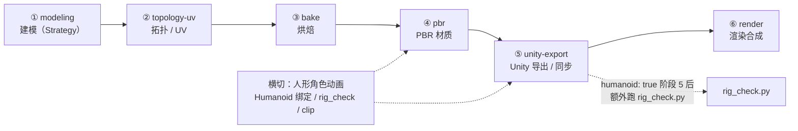

# 00 · 流水线总览（游戏美术管线向）

> 面向读者：**Unity 主程 + TA**。本文按「建模 → 拓扑/UV → 烘焙 → PBR 材质 → Unity 导出/同步 → 渲染合成」的工作流顺序组织整套文档。
> **唯一真相来源是 [SPEC.md](../SPEC.md)（规范性契约）与 [AGENTS.md](../AGENTS.md)（版本硬性约束）；本文与其冲突时以它们为准。**

## 1. 目标

把「一张参考图 / 一段参数」变成 Unity（URP）可直接使用的 3D 游戏资产，覆盖**人形角色、道具、人形角色动画**。

流水线的价值在于把这件事标准化：固定工具版本、固定坐标系、固定阶段顺序、固定命名与校验，避免每次手动点导出参数、每次排查「为什么 Unity 里是粉材质 / T-pose」。

## 2. 工具链版本表（硬性锁定）

| 工具 / 组件 | 版本 / 地址 | 在流水线中的角色 |
|-------------|-------------|------------------|
| **Go** | **1.27** | 我们自己写的代码：CLI `assetctl`、编排器、策略注册表、配置、校验、参考图处理；**零第三方依赖，仅标准库** |
| **Blender** | **5.2**（本机安装版本） | 六阶段里全部 `bpy` 脚本的运行时；无头调用 `blender --background --factory-startup --python <script> -- ...` |
| Blender 内置 Python | 随 Blender 5.2 自带（原生 `bpy`） | 不假设系统 Python、不在 Blender 里 `pip install`，「他原生代码用什么就用什么」 |
| **Tripo** | **https://studio.tripo3d.com/** | 浏览器端图生 3D / 文生 3D / 自动绑定与动画；是建模阶段的可选策略之一 |
| 系统 Python | **3.14**（本机 3.14.3） | 仅开发机上的辅助检查，**不进入交付流水线** |
| Unity | URP 优先（`unity-urp`） | 最终导入、Import Settings、Prefab / Animator |
| ACT（参考插件） | ACT 2025.2，GPL-3.0 | 外部可选插件，只对齐行为与参数、不 vendoring 源码；详见 [60-act-integration.md](60-act-integration.md) |

版本 / URL 的硬性约束写在 AGENTS.md；任何升级必须先改 AGENTS.md 再改脚本与文档。本仓库许可 **MIT**。

## 3. 多策略概念（建模阶段可替换）

「建模」阶段是**可替换策略**，其余五个阶段共享同一条流水线。Tripo 只是策略之一，**Blender 是默认策略**。

| id | 名称 | 阶段 1 实现 | 自动化程度 |
|----|------|-------------|-----------|
| `blender` | 参数化建模（**默认**） | `scripts/blender/stage_01_modeling.py` | 全自动 |
| `tripo` | 浏览器图生 3D | 人工在 https://studio.tripo3d.com/ 上传 → 下载 GLB 到 `raw/<id>.glb` | 半自动（Go 检测文件、给指引、可断点续跑） |
| `import` | 导入已有模型 | 复制 `config.source` 到 `raw/<id>.<ext>` | 全自动 |

所有策略的产物统一落到 `raw/<id>.glb`（或 `.fbx` / `.obj`），随后进入**同一条**共享流水线。详见 [10-strategies.md](10-strategies.md)。

## 4. 六阶段流程图（顺序固定）



| # | 阶段 id | 名称 | 实现 |
|---|---------|------|------|
| 1 | `modeling` | 建模 | 由所选 **Strategy** 提供 |
| 2 | `topology-uv` | 拓扑 / UV | `scripts/blender/stage_02_topology_uv.py` |
| 3 | `bake` | 烘焙 | `scripts/blender/stage_03_bake.py` |
| 4 | `pbr` | PBR 材质 | `scripts/blender/stage_04_pbr.py` |
| 5 | `unity-export` | Unity 导出 / 同步 | `scripts/blender/stage_05_unity_export.py` + Go 同步/校验 |
| 6 | `render` | 渲染合成 | `scripts/blender/stage_06_render.py` |

横切关注点：**人形角色动画**（Humanoid 绑定、rig 校验、clip 导出）贯穿阶段 4/5，见 [50-humanoid-animation.md](50-humanoid-animation.md)。

阶段间文件契约（Go runner 统一传递）：

```
--asset <id> --config <asset.json 路径> --in <上一阶段产物> --out <本阶段产物> [--blend-out <中间 .blend>]
```

退出码：`0` 成功；非 `0` 失败，错误写 stderr。所有脚本必须容忍 `--factory-startup`（不依赖用户偏好）。

## 5. 三种资产类型

| 类型 | 特征 | 关键门禁 |
|------|------|----------|
| **道具 / 静态物** | 无骨骼、无动画，单网格或少量网格 | 面数预算、UV、PBR 贴图；`kind: prop`、`humanoid: false` |
| **人形角色（含/不含绑定）** | 带 Armature，骨骼对齐 Unity Humanoid | `humanoid: true`，阶段 5 后必过 `rig_check.py`，Avatar 映射无红项 |
| **人形角色动画** | 在上者基础上带 clip（idle/walk/run/attack/hurt/death） | 循环标记正确、FBX `bake_anim = True`、Animator 配置，详见 [50](50-humanoid-animation.md) |

三种类型共用同一条六阶段流水线，差异由 `asset.json` 的 `kind` / `humanoid` / `animations` 字段驱动。

## 6. DoD 清单（Definition of Done）

SPEC.md §11 的总门禁：

- [ ] 资产 ID 为小写连字符（如 `hero-knight`），clip 为 `hero-knight-idle`
- [ ] `assetctl validate` 通过（含 `--expect-humanoid` / `--expect-textures` 按需）
- [ ] 贴图齐全且后缀正确：`_basecolor` / `_normal` / `_roughness` / `_metallic` / `_ao`
- [ ] 坐标系 `-Z forward / Y up`、缩放 `1.0`，对齐 `asset.json.axes`
- [ ] 面数符合预算、贴图 ≤ `budget.maxTextureSize`
- [ ] Unity 中**无粉材质**（贴图/Shader 丢失）
- [ ] Unity 中**无 T-pose**（Avatar 未配置或骨骼命名错位）
- [ ] Humanoid **Avatar 映射无红项**
- [ ] `build/<id>/manifest.json` 记录各阶段状态与 DoD 结果
- [ ] 文档对应清单项已勾选（[70-naming-and-dod.md](70-naming-and-dod.md)）

## 7. 目录结构

```
assets/<id>/asset.json          资产配置（JSON，Go encoding/json）
raw/<id>.*                      策略产物（原始，保留，便于回溯）
raw/<id>.png                    归一化参考图
work/<id>/NN-<stage>.blend      阶段中间 .blend
build/<id>/<id>.fbx             最终 Unity 资产
build/<id>/<id>_basecolor.png   PBR 贴图（normal/roughness/metallic/ao 同理）
build/<id>/preview.png          阶段 6 渲染合成图
build/<id>/manifest.json        阶段状态 + DoD 结果
scripts/blender/                Blender 5.2 内置 Python（bpy）阶段脚本
cmd/assetctl/                   Go 1.27 CLI 入口
internal/strategy/              Go 1.27 策略接口与注册表
internal/{config,runner,reference,validate}/  Go 1.27 编排/配置/参考图/校验
docs/                           本套中文文档
examples/                       配置与清单示例
```

阶段产物明细见 [SPEC.md §5](../SPEC.md)；`asset.json` 字段见 [SPEC.md §7](../SPEC.md)。

## 8. 文档索引

| 文档 | 覆盖 |
|------|------|
| [00-overview.md](00-overview.md) | 本文：目标、版本表、多策略、六阶段、资产类型、DoD、目录 |
| [10-strategies.md](10-strategies.md) | Strategy 接口、三策略对比、tripo 半自动、扩展、切换 |
| [20-stage-01-modeling.md](20-stage-01-modeling.md) | ① 建模：参数化 / Tripo 图生 3D / import |
| [30-stage-02-topology-uv.md](30-stage-02-topology-uv.md) | ② 拓扑 / UV：面数预算、Decimate、UV、LightmapUV、Seams |
| [40-stage-03-bake.md](40-stage-03-bake.md) | ③ 烘焙：normal/AO/曲率、高模→低模、命名、Cycles/EEVEE |
| [41-stage-04-pbr.md](41-stage-04-pbr.md) | ④ PBR 材质：五张图、Principled→URP/Lit、Non-Color |
| [42-stage-05-unity-export.md](42-stage-05-unity-export.md) | ⑤ Unity 导出/同步：FBX 参数、坐标系、Import Settings、manifest |
| [43-stage-06-render-composite.md](43-stage-06-render-composite.md) | ⑥ 渲染合成：三点光、相机、EEVEE、preview.png |
| [50-humanoid-animation.md](50-humanoid-animation.md) | 横切：两条绑定路线、骨骼命名、rig_check、clip、坑 |
| [60-act-integration.md](60-act-integration.md) | ACT 参考插件能力映射与许可证边界 |
| [61-language-split.md](61-language-split.md) | 语言分工：Go 1.27 / Blender 内置 Python / 系统 Python 3.14 |
| [70-naming-and-dod.md](70-naming-and-dod.md) | 命名规范 + 逐项 DoD + `assetctl validate` |
| [80-cli-reference.md](80-cli-reference.md) | `assetctl` 完整 CLI 参考 + manifest.json + CI 示例 |
